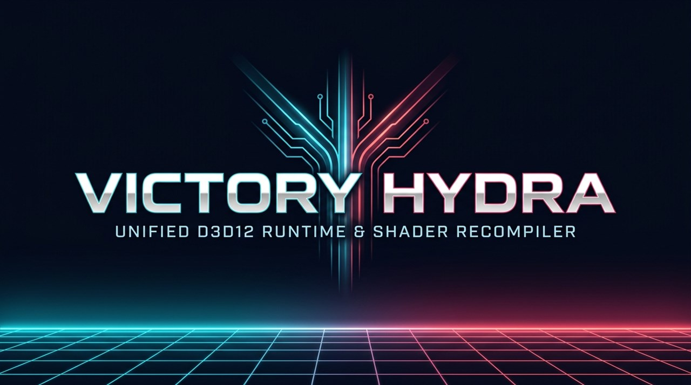
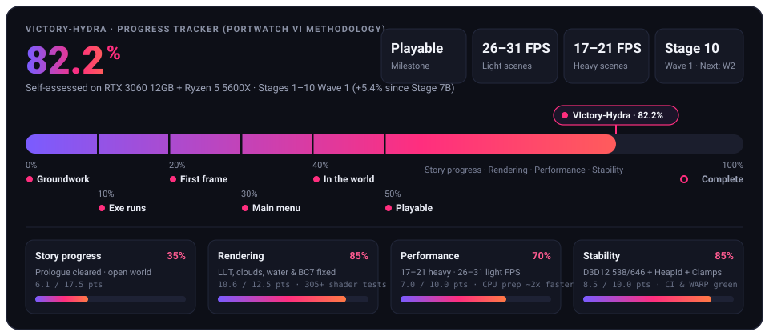

<p align="center">
  
</p>

<h1 align="center">VIctory-Hydra</h1>

<p align="center">
  <b>Unified multi-fork Direct3D 12 runtime, shader recompiler &amp; performance branch of VIctory</b><br>
  Combining verified performance, stability, shader-correctness, and tooling upgrades from across the community into one benchmarked, regression-tested Windows runtime.
</p>

<p align="center">
  
  
  
  
</p>

<p align="center">
  <b>Language:</b> <b>English</b> · <a href="README.ru.md">Русский (README.ru.md)</a>
</p>

---

## What is VIctory-Hydra?

**VIctory-Hydra** is a community-driven "Frankenstein" unification branch built on top of `cool_fox` / `VIctory`. Instead of leaving breakthroughs scattered across a dozen incompatible forks, every major optimization and shader fix is cherry-picked, adapted cleanly, and **A/B benchmarked on real NVIDIA RTX & mid-range CPU hardware** — keeping what genuinely improves frame time, stability, or visual fidelity, and disabling or fixing what regresses.

> **Legal & Asset Policy Notice:** This repository contains **zero** copyrighted game code, binaries, textures, shaders, audio, or screenshots. Every runtime file is supplied locally by the user from their own legal dump, enforced automatically by `cargo xtask policy` and `.githooks/pre-commit`. See [docs/asset-policy.md](docs/asset-policy.md).

---

## New Features (Stages 8 – 10 Wave 1)

Highlights shipped since Stage 7B — all following the **no-compromise quality policy** (zero stripped geometry, lighting, water, or LODs):

- **Placed-Copy Forwarding & Dynamic Descriptor Slabs (`VICTORY_PLACED_FORWARD=1`, `VICTORY_DYNAMIC_SLAB=1`, `VICTORY_ASYNC_RECYCLE=1`):** Eliminated `BEHIND_PLACED` GPU stalls (`21.3–23.0 ms → 0.0–1.8 ms`) and cut `HostHeap::dynamic` mutex contention from `26.9 ms → 0.5 ms` across 6,400+ tables/frame, plus monotonic `HostHeap::id` guards so stale lists never free slots in a recycled heap.
- **CPU Scheduler, Helper Priority & Preallocated Buffers (`VICTORY_HELPER_PRIORITY`, `VICTORY_DSTORAGE_PRIORITY=-1`, `VICTORY_BUFFERS_AHEAD`, `VICTORY_PATCH_LEAN=1`, `VICTORY_INPLACE_CONSTANTS=1`):** Raised `heap-sync`, `aside`, `land`, and `wide` helpers to `ABOVE_NORMAL` while yielding DirectStorage decompression threads (`heaps' records` wait cut from `4.2–9.8 ms → 1.8–2.3 ms`), preallocated 64 KiB buffers ahead of world entry, and gated Release `PLACED_RAW` tracking out of `texture_at()`.
- **Deterministic Static Samplers & NVIDIA 32-Lane Shader Fixes (`VICTORY_SAMPLER_ORDER`, `VICTORY_THREAD_TICKET`, `VICTORY_LDS_LOOP_ATOMICS`, `VICTORY_LDS_BOUNDS`, `VICTORY_LDS_FIRST_INIT`, `VICTORY_LOOPS_WAVE`, `VICTORY_EARLY_DEPTH`):** Fixed 3D LUT color banding (`PS_CompositeNMB`), cloud tile holes (`CS_SortRayTiles`), water dark blocks, 2D `32×2` group lane assignment on NVIDIA, BC7 mode 4/5 rotation, and violet probe artifacts in ambient light.
- **D3D12 Validation, Memory Guardrails & Fast Tooling:** Fixed D3D12 error `538` (separate `ExecuteCommandLists` for buffer comparisons) and error `646` (ambient depth SRV type/dimension check), added `VICTORY_RAW_VIEW_CLAMP`, `VICTORY_VRAM_BUDGET_MB`, `VICTORY_SKIP_BINK=1`, `VICTORY_AUTO_A=90`, auto-staged Agility SDK `D3D12\D3D12Core.dll` in launchers, and fixed offline frame replay on Agility SDK `1.620.2`.

### Before vs. After (`Stage 7B → Stage 10 Wave 1`, RTX 3060 12 GB + Ryzen 5 5600X)

| Metric | Before (Stage 7B) | Now (Stages 8 – 10 Wave 1) |
| :--- | :--- | :--- |
| **Light World Scenes (`1,000–1,750 draws`)** | `13–14 FPS` (`~70–80 ms`) | **`25.9–30.8 FPS`** (`32.5–38.7 ms`) |
| **Heavy World Scenes (`2,800–3,700 draws`)** | `11.2 FPS` (`89.0 ms`) | **`16.9–20.9 FPS`** (`47.8–59.2 ms`) |
| **CPU Frame-Prep (at `~6,300–7,700 draws`)** | `60–69 ms/frame` | **`36.9 ms/frame`** (~1.8–2× faster) |
| **`BEHIND_PLACED` Stalls** | `21.3–23.0 ms/frame` | **`0.0–1.8 ms/frame`** |
| **`HostHeap::dynamic` Contention** | `26.9 ms/frame` | **`0.5 ms/frame`** |
| **Waiting for `heaps' records`** | `4.2–9.8 ms/frame` | **`1.8–2.3 ms/frame`** |
| **D3D12 Debug Layer (`538` / `646`)** | Active (`538` compare state + `646` depth SRV) | **Fixed in submission & ambient pass** |
| **Visual Fidelity (NVIDIA 32-lane)** | 3D LUT banding, cloud holes, water blocks, violet probes | **All fixed without cutting visual effects** |

---

## Current Progress, FPS & Test PC Specs

> Self-assessed using the public [PortWatch VI](https://portwatch-vi.xyz/) scoring model (`50` base pts for milestones `Groundwork → Playable` + `17.5` Story + `12.5` Rendering + `10` Performance `[mean FPS ÷ 30]` + `10` Stability). Note: `VIctory-Hydra` is a self-reported community unification branch, not independently ranked on PortWatch.

<p align="center">
  
</p>

### Subsystem Breakdown (Measured Locally)
| Track | Score | Current State |
| :--- | :--- | :--- |
| **Milestones (`0–50%`)** | `50.0 / 50.0 pts` (`100%`) | `Groundwork` ● `Exe runs` ● `First frame` ● `Main menu` ● `In the world` ● `Playable` |
| **Story progress (`17.5 pts`)** | `6.1 / 17.5 pts` (`35%`) | Prologue cleared; open-world gameplay & HUD active (full late-game campaign untested locally) |
| **Rendering (`12.5 pts`)** | `10.6 / 12.5 pts` (`85%`) | 3D LUT banding, cloud holes, water blocks, BC7 rotation, 32×2 wave ticket & violet probes fixed; `305+` shader tests pass |
| **Performance (`10.0 pts`)** | `7.0 / 10.0 pts` (`70%`) | **`25.9–30.8 FPS`** light scenes · **`16.9–20.9 FPS`** heavy scenes (`60.0 FPS` menus) vs `30 FPS` target |
| **Stability (`10.0 pts`)** | `8.5 / 10.0 pts` (`85%`) | D3D12 `538`/`646` fixed, `HostHeap::id` guard, `VICTORY_RAW_VIEW_CLAMP`, `VICTORY_VRAM_BUDGET_MB`, WARP + RTX CI green |
| **Total** | **`82.2%`** | **`+5.4%`** since Stage 7B (`76.8% → 82.2%`) |

### Reference Hardware (Primary Test Rig)
| Component | Specification |
| :--- | :--- |
| **OS** | Windows 11 x64 (Build `22621`) |
| **CPU** | AMD Ryzen 5 5600X (6 Cores / 12 Threads, Zen 3) |
| **GPU** | NVIDIA GeForce RTX 3060 12 GB (`ID3D12Device13`, D3D12 Agility SDK `1.620.2`, ~11,345 MiB VRAM budget) |
| **RAM** | 32 GB DDR4 |
| **Storage** | HDD for game dump · SSD for `%LOCALAPPDATA%` shader & pipeline cache |

### Current Performance & Status (`1280×720`, `render_scale = 0.667`, `--console series-s`)
- **Menus / Loading:** `60.0 FPS` (`16.7 ms/frame`).
- **Light Open-World Scenes (`1,020–1,742 draws/frame`):** **`25.9–30.8 FPS`** (`32.5–38.7 ms/frame`).
- **Heavy Open-World Scenes (`2,838–3,675 draws/frame`):** **`16.9–20.9 FPS`** (`47.8–59.2 ms/frame`).
- **Opening Streaming Burst (`7,633–9,391 draws/frame`, cold world pipelines):** `10.9 FPS` median (`36.9 ms` CPU prep after streaming settles).
- **Next Target:** Push heavy world scenes past **`30 FPS`** on 6 cores in **Stage 10 Wave 2** (`VICTORY_WATCH_RESERVATION`, `VICTORY_COPY_SMALL`, `VICTORY_ASYNC_PRESENT` + `VICTORY_FRAMES_AHEAD=2`).

### Stage Roadmap
| Stage | Focus | Status |
| :--- | :--- | :--- |
| **Stages 1–5** | Core `cool_fox` pareto residency, 256-shard guard locks, NaN scrub, eager decoration/face bakes, mesh launch setup | Done |
| **Stages 6–6.1** | `MSInfo.PayloadSizeInBytes` fix (unlocking 1,762 mesh pipelines), removal of ~3,964 global UAV barriers/frame, card-window VRAM budgets, HDD elevator I/O sort | Done |
| **Stages 7–7B** | Automated bench/A-B/replay harness, live A/B regression fixes (`VICTORY_UM_WATCH=0`, `constant:0.8`), Neptune `victory-shader` fixes | Done |
| **Stage 8** | `VICTORY_PATCH_LEAN=1`, `VICTORY_INPLACE_CONSTANTS=1`, `VICTORY_UM_COALESCE_KB=0`, `ir::whole_sections` & `POPS` fixes (`11–14 → 17–31 FPS`) | Done |
| **Stage 9 (Waves 1–2)** | `VICTORY_PLACED_FORWARD=1`, `VICTORY_DYNAMIC_SLAB=1`, `VICTORY_ASYNC_RECYCLE=1`, lock-free `Shadow::pending`, 6-core worker balance, Agility SDK auto-staging & offline replay fixes | Done |
| **Stage 10 Wave 1** | `PLACED_RAW` diag-gating, `VICTORY_HELPER_PRIORITY`, `HostHeap::id` guard, `VICTORY_RAW_VIEW_CLAMP`, D3D12 `538`/`646` fixes, `VICTORY_SKIP_BINK`, `VICTORY_VRAM_BUDGET_MB`, `VICTORY_BUFFERS_AHEAD`, `VICTORY_SAMPLER_ORDER`, `VICTORY_THREAD_TICKET`, cloud/water LDS fixes, BC7 rotation & `VICTORY_EARLY_DEPTH` | Done |
| **Stage 10 Wave 2** | `VICTORY_WATCH_RESERVATION` + `VICTORY_COPY_SMALL`, `VICTORY_ASYNC_PRESENT` + `VICTORY_FRAMES_AHEAD=2`, `dstorage` `cancel`/`error_record` + `MESH_PRIM_9BIT`, A/B `VICTORY_WAVE64_PAIRED` | Next |

---

## Highlights & Unified Features

### 1. Renderer, Submission & Memory Pipeline
- **Multithreaded Thin-List Recording & Async Submission (`VICTORY_THIN=1`, `VICTORY_RELAY=2`, `VICTORY_ASYNC_SUBMIT=1`):** Moves D3D12 command-list translation, descriptor recording, AVX2 dirty compares, and submit joins off the title's threads onto dedicated worker pools.
- **Pareto Memory Residency & 32 GB RAM / 8–12 GB VRAM Stability:** Adaptive GPU memory residency budgets (`VICTORY_CARD_BUFFERS_MB`, `VICTORY_CARD_WINDOWS_MB`, `VICTORY_SETTLE_ROOM=1`), preventing WDDM paging exhaustion (`0x8007000E`) and periodic device-loss crashes.
- **Renderer Ports & Fast Paths:**
  - `VICTORY_PORT_CONSTANTS`, `VICTORY_PORT_DESCRIPTORS`, `VICTORY_PORT_GUARD`, `VICTORY_PORT_JOURNAL`
  - `VICTORY_UP_QUEUE=1`, `VICTORY_JOIN_BARRIERS=1`, `VICTORY_READBACK_POOL=1`, `VICTORY_TEXBACK_ASYNC=1`
  - `VICTORY_UM_TEXLOOK=1` (fast texture lookup epoch), `VICTORY_REMAP_SAME=1` & `VICTORY_ALIAS_RUNS=1` (cheap virtual memory alias remaps), `VICTORY_UM_COALESCE_KB=0` (prevents surface corruption)
  - Lock-free console instruction counter fast path (`SEEN_ALL`) and deferred pipeline library persistence (`VICTORY_LIBRARY_STORE_LATER=1`)
- **DirectStorage Fast I/O (`VICTORY_DSTORAGE_IO=handles`, `VICTORY_DSTORAGE_SORT=1`):** Parallel handle-based reads and offset-sorted queues to cut loading times even on HDDs.

### 2. Shader Recompiler (`victory-shader`) & NVIDIA / AMD Fixes
- **NVIDIA LDS Atomic Sub Workaround:** Detects negated values (`negation_of`) and lowers affected LDS atomic loops cleanly to avoid NVIDIA DXIL driver edge cases.
- **DXIL CFG & Loop Normalization:** Expanded loop trace budget (`TRACE_LOOP_LIMIT=1024`), single-latch CFG normalization, `one_mode_per_register`, `whole_sections` / `permutes_outside_sections`, and `unused_descriptor_kind` structured handles.
- **Instruction & Intrinsic Coverage:** `Input::GroupInfo`, `s_pack_{ll,lh,hh}_b32_b16`, `wave_local` `v_mad_u32_u24` / `u16`, `s_bfm_b32` / `s_mov_b64` literal resource recovery, voxel visibility wave64 mask provenance, and shader LOD slot fix.
- **Offline Resume-Safe Pipeline Pre-Compiler:** `Warm-Shaders.cmd` (`victory warm --used`) with live progress percentage, compile rate, and ETA to eliminate in-game shader stutter after updates.

### 3. Visual Fidelity & Upscaler Integration
- **Balanced Ambient & Reflection Pass (`VICTORY_AMBIENT=constant:0.8`, `VICTORY_AMBIENT_REFLECT=0.5`):** Even interior/exterior lighting without doorway blowouts plus `CS_UpdateHistory` reflection shading (`Role::Reflect`), and `VICTORY_NAN_SCRUB=1` against NaN bloom artifacts.
- **Texture Longevity & Mode Control:** `VICTORY_STALE_KEEP_MS=10000` / `VICTORY_STALE_KEEP_MAX_MS=120000` + `VICTORY_TEXTURE_BACK_MODES=0` to reduce texture pop-in and readback stalls.
- **Custom Resolution, Render Scale & Pacing:** `VICTORY_OUTPUT`, `VICTORY_RENDER_SCALE`, `VICTORY_FRAME_INTERVAL_MS` (60/120 FPS pacing while keeping game simulation clock at 1.00x).
- **External PC Upscaler Hook (`VICTORY_FSR_DLL`):** Optional redirect for PC FidelityFX / OptiScaler DLLs without modifying game files.

### 4. Automated Benchmarking & Live A/B Testing
- **Built-in Benchmark & A/B Harness (`tools/bench-gta6.ps1`):**
  - `live` mode: timed world-frame benchmark with automatic warmup and exit (`VICTORY_BENCH_WORLD_S`, `VICTORY_BENCH_WARMUP_S`).
  - `ab` mode: live in-world A/B toggling of runtime flags (`VICTORY_AB`, `VICTORY_AB_WORLD=1`) to prove every flag's real frame-time delta.
  - `record` / `replay` mode: capture a deterministic world frame and replay GPU/shader passes in ~5 seconds without rebooting the title.

---

## Requirements & Dependencies

- **OS:** Windows 10 (19041+) / Windows 11 x64
- **CPU:** x86-64 with AVX2 (6+ cores recommended)
- **GPU:** Direct3D 12 GPU with Shader Model 6.6 & Mesh Shaders (NVIDIA RTX 20/30/40/50 or AMD RX 6000/7000/9000; 8 GB+ VRAM recommended, 4 GB profile included) + up-to-date GPU driver (NVIDIA `566+` / AMD Adrenalin)
- **RAM:** 32 GB recommended
- **Game Files:** Your own legal Xbox Series dump (`game_scarlett_master.exe` and data files stored **outside** this repository)

### Required Runtime & Build Dependencies

1. **DirectX 12 Agility SDK (`D3D12\D3D12Core.dll` — REQUIRED, exact version `1.620.2`):**
   - `victory.exe` exports `D3D12SDKVersion = 620` and `D3D12SDKPath = ".\D3D12\"`. If `D3D12\D3D12Core.dll` is missing next to the launched `.exe`, older than `1.620.x` (e.g. `1.614`–`1.619`), wrong arch (`x86`/`arm64`), or a `1.7xx-preview` DLL without Windows Developer Mode, Windows refuses it with **`0x887E0003`** (`D3D12_ERROR_INVALID_HOST_EXE_SDK_VERSION_CONFIGURATION`), followed by `D3D12 XDXR Error: D3D12SerializeVersionedRootSignature`.
   - Download [`Microsoft.Direct3D.D3D12` `1.620.2`](https://www.nuget.org/packages/Microsoft.Direct3D.D3D12/1.620.2) (stable, **not** `1.7xx-preview`), extract `build\native\bin\x64\D3D12Core.dll` into a `D3D12\` subfolder **in the same directory as `victory.exe`** (or run this PowerShell snippet):
     ```powershell
     # Downloads Microsoft.Direct3D.D3D12 1.620.2 (x64) into target\release\D3D12\
     New-Item -ItemType Directory -Force "target\release\D3D12" | Out-Null
     Invoke-WebRequest "https://api.nuget.org/v3-flatcontainer/microsoft.direct3d.d3d12/1.620.2/microsoft.direct3d.d3d12.1.620.2.nupkg" -OutFile "$env:TEMP\d3d12_agility.zip"
     Expand-Archive "$env:TEMP\d3d12_agility.zip" "$env:TEMP\d3d12_agility" -Force
     Copy-Item "$env:TEMP\d3d12_agility\build\native\bin\x64\D3D12Core.dll" "target\release\D3D12\" -Force
     # Verify Agility SDK loads cleanly (must print D3D12Core.dll path & ID3D12Device13 true):
     .\target\release\victory.exe probe
     ```
2. **Microsoft Visual C++ Redistributable 2015–2022 (x64):** required by `VCRUNTIME140.dll` and title DLLs ([direct download](https://aka.ms/vs/17/release/vc_redist.x64.exe)).
3. **Build Tools (when compiling from source):**
   - **Rustup** ([rustup.rs](https://rustup.rs/)) — automatically installs the pinned toolchain from `rust-toolchain.toml`
   - **Visual Studio 2022 Build Tools** with *Desktop development with C++* + *Windows 10/11 SDK*
   - **Git**

Quick `winget` install for all Windows prerequisites:
```powershell
winget install Microsoft.VCRedist.2015+.x64
winget install Git.Git
winget install Rustlang.Rustup
winget install Microsoft.VisualStudio.2022.BuildTools --override "--wait --passive --add Microsoft.VisualStudio.Workload.VCTools --includeRecommended"
```

---

## Quick Start

### 1. Clone & Build

```powershell
git clone https://github.com/ToLIManl/VIctory-Hydra.git
cd VIctory-Hydra

# Release runtime (fastest, for playing)
cargo build --release --locked -p victory

# Optional: Diagnostics build (for frame replay, A/B profiling, captures)
cargo build --locked --profile diag -p victory --features diagnostics
```

### 2. Point to Your Local Game Dump

Set `VICTORY_GAME_DIR` to the folder containing your `game_scarlett_master.exe` (or place this repo next to a sibling `..\Game\` folder):

```powershell
$env:VICTORY_GAME_DIR = "D:\Games\MyDump"
```

Alternatively, copy `victory.example.toml` to `victory.toml` (git-ignored) and edit `game_dir`.

### 3. Launch

```powershell
# Recommended unified preset (override any VICTORY_* variable before launching)
.\Play-VIctory.cmd

# 4 GB / low-VRAM preset
.\Play-VIctory-4GB.cmd
```

To run in 1080p instead of the default 720p performance baseline:

```powershell
$env:VICTORY_OUTPUT = "1920x1080"
$env:VICTORY_RENDER_SCALE = "0.75"
.\Play-VIctory.cmd
```

### 4. Pre-Compile Shaders & Pipelines (Recommended After Updates)

```powershell
.\Warm-Shaders.cmd
```

Progress is saved incrementally (`warm-done.txt`), so you can stop (`Ctrl+C`) and resume anytime.

---

## Automated Benchmarking & Frame Replay

Use [tools/bench-gta6.ps1](tools/bench-gta6.ps1) to measure changes objectively:

```powershell
# Timed release benchmark (20s of world frames after 6s warmup)
.\tools\bench-gta6.ps1 -Mode live -WorldS 20 -Tag baseline

# Live in-world A/B test of runtime flags
.\tools\bench-gta6.ps1 -Mode ab -PhaseS 10 -AbSwitches "VICTORY_UM_TEXLOOK=0,VICTORY_UM_TEXLOOK=1" -Tag ab-texlook

# Capture a single world frame and replay it offline in seconds
.\tools\bench-gta6.ps1 -Mode record -Tag capture1
.\tools\bench-gta6.ps1 -Mode replay
```

---

## Repository Hygiene & Asset Policy

Install the pre-commit hook before contributing:

```powershell
cargo xtask install-hooks
cargo xtask policy
```

For maintainers publishing periodic updates, [tools/push-update.ps1](tools/push-update.ps1) runs `cargo xtask policy` and scans all tracked files for accidental local-path leaks before committing.

---

## Credits & Upstream Projects

This project stands on the shoulders of the entire VIctory / PortWatch community:

- **[VIctory](https://github.com/Marvisak/VIctory)** (Marvisak & contributors) — original loader, HLE services, D3D12 backend, and shader recompiler.
- **cool_fox / CGBJ** (codec-d & DoubleGhosty) — Pareto residency architecture, NVIDIA stability baseline, and core continuation.
- **Neptune_VI** — shader lowering upgrades (`one_mode_per_register`, `whole_sections`, LDS atomic workarounds, reflection ambient pass, coalescing & replay refinements).
- **[fxceless/victory-fork](https://github.com/fxceless/victory-fork)** — thin-list recording, async submission, relay/landing pipeline, frame recorder/replay, and diagnostic tooling.
- **AvatarManz (`VIctory-7900XTX`)** — multithreaded recording, framerate pacing unlock, and renderer ports.
- **Vice-Tay**, **Kelvaroq**, **[DexNom/VIctory](https://github.com/DexNom/VIctory)**, **[Belobug/VIctory-Belobug-AMD](https://github.com/Belobug/VIctory-Belobug-AMD)**, **[myokex/victory-amd](https://github.com/myokex/victory-amd)**, **[FQY55kai/ZJOU-VICTORY](https://github.com/FQY55kai/ZJOU-VICTORY)**, **Geckomacabre**, **cxy0072019-sketch**, and **romainhedouin** — shader compiler passes, ambient lighting, texture readback, write-guard optimizations, and D3D12 fixes.

---

## License

Licensed under **GPL-3.0-or-later**, matching upstream VIctory. See [LICENSE](LICENSE) and [docs/asset-policy.md](docs/asset-policy.md).
