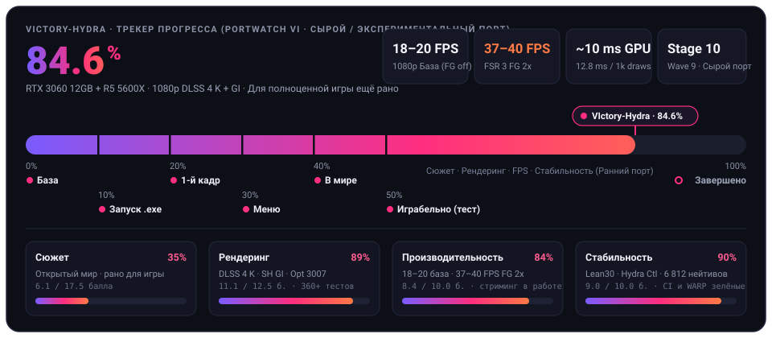

<p align="center">
  
</p>

<h1 align="center">VIctory-Hydra</h1>

<p align="center">
  <b>Объединённый мультифорк Direct3D 12-рантайма, рекомпилятора шейдеров и оптимизаций на базе VIctory</b><br>
  Собираем лучшие наработки по производительности, стабильности, шейдерам и инструментам из разных форков в одном протестированном рантайме под Windows.
</p>

<p align="center">
  
  
  
  
</p>

<p align="center">
  <b>Язык:</b> <a href="README.md">English (README.md)</a> · <b>Русский</b>
</p>

---

## Что такое VIctory-Hydra?

**VIctory-Hydra** — это «франкенштейн»-ветка поверх `cool_fox` / `VIctory`. Вместо того чтобы держать удачные патчи разбросанными по десяти несовместимым форкам, сюда переносятся ключевые улучшения по производительности, шейдерам и стабильности — **с обязательной A/B-проверкой на реальном железе (NVIDIA RTX + 6-ядерный CPU)**: всё, что реально ускоряет кадр и чинит картинку, остаётся; всё, что даёт регрессию, отключается или переписывается.

> **Ранний / экспериментальный статус — для полноценного прохождения ещё рано:** выход на **~18–20 базовых FPS (37–40 FPS с FSR 3 Frame Generation 2x)** в `1080p` на RTX 3060 + Ryzen 5 5600X — это настоящий прорыв, **но порт всё ещё сырой и активно дорабатывается**. При массовой подгрузке текстур открытого мира FPS может проседать, при резких поворотах камеры встречаются фризы, а на части объектов ещё есть визуальные артефакты (квадратные тени, сбой тайлинга отдельных текстур). Сейчас это сборка для тестов, исследований и экспериментов, а не готовая замена релизу.

> **Юридическая политика и ассеты:** В репозитории **нет и не будет** файлов игры, бинарей, текстур, шейдеров, звука или скриншотов. Пользователь подключает собственный легальный дамп локально, а чистота репо автоматически проверяется через `cargo xtask policy` и `.githooks/pre-commit`. См. [docs/asset-policy.md](docs/asset-policy.md).

---

## Новые возможности (Stages 8 – 10 Waves 1–9)

Ключевые улучшения по **Stage 10 Wave 9** включительно — проверено вживую на **RTX 3060 12 GB + Ryzen 5 5600X**:

- **NVIDIA DLSS 4 (Preset K) + AMD FSR 3 Frame Generation 2x + направленное SH GI и отражения (`Waves 5–6`):** вывод `1080p` (внутреннее `720p` DLSS Quality) + HUD-less FSR 3 FG 2x (**37–40 FPS** на выходе из **18–20 базовых FPS**), направленное SH-освещение + спекулярные отражения (`CS_RayMiss`), фикс stencil-глубины и **17 живых настроек в меню `F1`** без перезапуска игры.
- **Батчевый GPU-детайлер, константы в VRAM и `CARD_COMPARE_EVERY=30` (`Waves 7–9`):** аппаратный `cs_5_1` детайлинг текстур (`VICTORY_GPU_DETILE=1`) на общем 128 MiB UAV scratch-буфере; `VICTORY_PORT_CONSTANTS=0` + `VICTORY_CARD_TOUCHED=1` + `VICTORY_CARD_COMPARE_EVERY=30` (с защитой masked-patch в `Lean::ahead`) убрали ~260 MB/кадр лишних GPU-сравнений и снизили `ms / 1k draws` на **37%** (`20.3 → 12.8 ms/1k`).
- **DXIL-оптимизатор (`3007`) и Wave32 LDS hazard analysis (`Wave 9`):** портированы opt-in проходы `EXT_FOLD`, `MEM_FWD`, `LICM`, `BARRIERS`, `SPEC_LICM` (без коллизии с `FAST=128`) и статический анализ LDS для 32-lane NVIDIA (`VICTORY_LDS_ANALYZE=1`), подтверждены бит-в-бит на RTX 3060 и сократили `on the GPU` почти вдвое (`16.2–22.7 ms → 9.1–10.4 ms`).
- **Контроль движка RAGE 9, ScriptHook VI и наш инструмент Hydra Control (`Waves 7–9`):** байт-верифицированные патчи RAGE 9 (`VICTORY_LOW_SHADOWS`, `VICTORY_LOW_VOLUMETRIC`), подмена файлов из `VICTORY_MODS_DIR`, загрузчик DLL `VICTORY_LOAD_DLLS` (`shvi_core.dll`, `6 812` нейтивов + `trainer.asi`), релизный профайлер шейдеров `VICTORY_PROF=1`, маркеры `VICTORY_PIX=1` и единая плоскость управления **Hydra Control** (`\\.\pipe\victory_hydra` + `hydra_bridge.asi` + `tools/hydra_ctl.py`).

### Было vs. Стало (`Stage 7B → Stage 10 Wave 9`, RTX 3060 12 GB + Ryzen 5 5600X)

| Показатель | Было (Stage 7B) | Сейчас (Stage 10 Wave 9) |
| :--- | :--- | :--- |
| **Базовый FPS в 1080p (FG OFF, GI + Specular + DLSS 4 K)** | `~10–12 FPS` (`720p` плоский свет) | **`16.7–20.0 FPS`** (стабильно `17.8–19.3 FPS`, просадки до `~10` на тяжёлом стриминге текстур) |
| **Выходной FPS в 1080p (FSR 3 Frame Gen 2x)** | Не было | **`35–40 FPS`** (до тяжёлых всплесков стриминга текстур) |
| **Стоимость 1 000 draw calls (`4 600+ draws`)** | `~20.3–25.0 ms / 1k draws` | **`12.8 ms / 1k draws`** (`-37%` к Wave 8) |
| **Работа GPU (`on the GPU`, `4 636 draws`)** | `16.2–22.7 ms` (Wave 8) | **`9.1–10.4 ms`** (`~2×` меньше с `CARD_COMPARE_EVERY=30` + `SHADER_OPT=3007`) |
| **CPU-время обновления текстур** | `~42.3 ms` скалярный CPU | **`1.1–2.3 ms`** (`VICTORY_GPU_DETILE=1` батчевый compute) |
| **Чтения GPU-сравнения (`CARD_COMPARE_EVERY=30`)** | Полные 182 MB × ~7 сабмитов | **`~4 166` кусков (`~260 MB/кадр`) пропущено**, `0` потерянных записей |
| **Инструменты и моддинг** | Только env-переменные | **`VICTORY_MODS_DIR` + `VICTORY_LOAD_DLLS` (`6 812` нейтивов) + Hydra Control pipe/CLI** |

---

## Текущий прогресс, замер FPS и характеристики тестового ПК

> Самооценка по открытой методике [PortWatch VI](https://portwatch-vi.xyz/) (`50` базовых баллов за вехи `База → Играбельно` + `17.5` Сюжет + `12.5` Рендеринг + `10` Производительность + `10` Стабильность). `VIctory-Hydra` — экспериментальная объединительная ветка (не подана в официальный рейтинг PortWatch).

<p align="center">
  
</p>

### Отдельный прогресс по подсистемам (локальные замеры)
| Категория | Баллы | Текущее состояние |
| :--- | :--- | :--- |
| **Вехи (`0–50%`)** | `50.0 / 50.0 б.` (`100%`) | `База` ● `Запуск .exe` ● `1-й кадр` ● `Меню` ● `В мире` ● `Играбельно` *(ранний/экспериментальный)* |
| **Сюжет (`17.5 б.`)** | `6.1 / 17.5 б.` (`35%`) | Пролог пройден, открытый мир и HUD работают (для полноценного прохождения ещё рано) |
| **Рендеринг (`12.5 б.`)** | `11.1 / 12.5 б.` (`89%`) | 1080p DLSS 4 Preset K, FSR 3 FG 2x, SH GI + Specular, DXIL opt `3007`, Wave32 LDS; часть багов теней/текстур в работе |
| **Производительность (`10.0 б.`)** | `8.4 / 10.0 б.` (`84%`) | **`17–20` базовых FPS / до `37–40 FPS` с FSR 3 FG 2x** (`12.8 ms/1k draws`, `~10 ms` GPU); есть просадки при стриминге |
| **Стабильность (`10.0 б.`)** | `9.0 / 10.0 б.` (`90%`) | `CARD_COMPARE_EVERY=30`, дин. резерв RT VRAM, `CARD_TOUCHED=1`, `360+` тестов шейдеров/GPU и WARP зелёные |
| **Итого** | **`84.6%`** | **`+2.4%`** с Wave 1 (`82.2% → 84.6%`) — **Сырой / экспериментальный порт** |

### Конфигурация тестового ПК
| Компонент | Характеристики |
| :--- | :--- |
| **ОС** | Windows 11 x64 (сборка `22621`) |
| **Процессор** | AMD Ryzen 5 5600X (6 ядер / 12 потоков, Zen 3) |
| **Видеокарта** | NVIDIA GeForce RTX 3060 12 GB (`ID3D12Device13`, D3D12 Agility SDK `1.620.2`, локальный бюджет ~11 345 MiB VRAM) |
| **ОЗУ** | 32 GB |
| **Накопители** | HDD под дамп игры · системный SSD под кэш шейдеров и пайплайнов (`%LOCALAPPDATA%`) |

### Текущий результат FPS (`1280×720`, `render_scale = 0.667`, `--console series-s`)
- **Меню / экраны загрузки:** `60.0 FPS` (`16.7 ms/кадр`).
- **Лёгкие сцены в мире (`1 020–1 742 draws/frame`):** **`25.9–30.8 FPS`** (`32.5–38.7 ms/кадр`).
- **Тяжёлые сцены в мире (`2 838–3 675 draws/frame`):** **`16.9–20.9 FPS`** (`47.8–59.2 ms/кадр`).
- **Пиковая подгрузка на входе в мир (`7 633–9 391 draws/frame`, холодные пайплайны):** медиана `10.9 FPS`, CPU-подготовка `36.9 ms/кадр` после выхода из всплеска.
- **Следующая цель:** пробить стабильные **`30+ FPS`** и в тяжёлых сценах на 6 ядрах в **Stage 10 Wave 2** (`VICTORY_WATCH_RESERVATION`, `VICTORY_COPY_SMALL`, `VICTORY_ASYNC_PRESENT` + `VICTORY_FRAMES_AHEAD=2`).

### Карта этапов разработки
| Этап | Что сделано / планируется | Статус |
| :--- | :--- | :--- |
| **Stages 1–5** | База `cool_fox` (Pareto-резидентность под 32 GB RAM), 256-шардовые блокировки, `NaN`-очистка, приоритетный прогрев шейдеров персонажей/лиц | Готово |
| **Stages 6–6.1** | Фикс `MSInfo.PayloadSizeInBytes` (разблокировано 1 762 mesh-пайплайна), убрано ~3 964 глобальных UAV-барьера/кадр, бюджеты VRAM, сортировка DirectStorage под HDD | Готово |
| **Stages 7–7B** | Автобенчмарк, живые A/B-тесты и оффлайн-реплей; исправление регрессий (`VICTORY_UM_WATCH=0`, `constant:0.8`); порт 8 фиксов `victory-shader` из `Neptune_VI` | Готово |
| **Stage 8** | `VICTORY_PATCH_LEAN=1`, `VICTORY_INPLACE_CONSTANTS=1`, `VICTORY_UM_COALESCE_KB=0`, фиксы `ir::whole_sections` и `POPS` (`11–14 → 17–31 FPS`) | Готово |
| **Stage 9 (Waves 1–2)** | `VICTORY_PLACED_FORWARD=1`, `VICTORY_DYNAMIC_SLAB=1`, `VICTORY_ASYNC_RECYCLE=1`, lock-free `Shadow::pending`, баланс потоков под 6 ядер, авто-подкладка Agility SDK и фиксы оффлайн-реплея | Готово |
| **Stage 10 Wave 1** | `PLACED_RAW` только в `diagnostics`, `VICTORY_HELPER_PRIORITY`, `HostHeap::id`, `VICTORY_RAW_VIEW_CLAMP`, фиксы D3D12 `538`/`646`, `VICTORY_SKIP_BINK`, `VICTORY_VRAM_BUDGET_MB`, `VICTORY_BUFFERS_AHEAD`, `VICTORY_SAMPLER_ORDER`, `VICTORY_THREAD_TICKET`, фиксы облаков/воды (LDS), BC7 и `VICTORY_EARLY_DEPTH` | Готово |
| **Stage 10 Wave 2** | `VICTORY_WATCH_RESERVATION` + `VICTORY_COPY_SMALL`, `VICTORY_ASYNC_PRESENT` + `VICTORY_FRAMES_AHEAD=2`, `dstorage` `cancel`/`error_record` + `MESH_PRIM_9BIT`, A/B-проверка `VICTORY_WAVE64_PAIRED` | В планах |

---

## Ключевые возможности и перенесённые улучшения

### 1. Рендерер, многопоточная отправка и память
- **Многопоточная запись и асинхронный сабмит (`VICTORY_THIN=1`, `VICTORY_RELAY=2`, `VICTORY_ASYNC_SUBMIT=1`):** выносит трансляцию списков команд D3D12, дескрипторов и AVX2-сравнение грязных страниц с потоков игры на пулы воркеров.
- **Pareto-бюджеты VRAM / RAM (`VICTORY_CARD_BUFFERS_MB`, `VICTORY_CARD_WINDOWS_MB`, `VICTORY_SETTLE_ROOM=1`):** предотвращает переполнение WDDM-пейджинга (`0x8007000E`) и вылеты на 32 GB RAM и видеокартах 8–12 GB.
- **Порты рендерера и быстрые пути:**
  - `VICTORY_PORT_CONSTANTS`, `VICTORY_PORT_DESCRIPTORS`, `VICTORY_PORT_GUARD`, `VICTORY_PORT_JOURNAL`
  - `VICTORY_UP_QUEUE=1`, `VICTORY_JOIN_BARRIERS=1`, `VICTORY_READBACK_POOL=1`, `VICTORY_TEXBACK_ASYNC=1`
  - `VICTORY_UM_TEXLOOK=1` (быстрый индекс текстур), `VICTORY_REMAP_SAME=1` и `VICTORY_ALIAS_RUNS=1`, `VICTORY_UM_COALESCE_KB=0` (устраняет порчу поверхностей)
  - `SEEN_ALL` без блокировок в эмуляции счётчика инструкций и отложенное сохранение кэша пайплайнов (`VICTORY_LIBRARY_STORE_LATER=1`)
- **DirectStorage-ускорение под HDD (`VICTORY_DSTORAGE_IO=handles`, `VICTORY_DSTORAGE_SORT=1`):** многопоточное чтение по хэндлам и сортировка пакетов по смещению для сокращения времени загрузки с HDD.

### 2. Рекомпилятор шейдеров (`victory-shader`) и фиксы под NVIDIA / AMD
- **Обход бага NVIDIA DXIL с LDS atomic sub (`negation_of` + `lds_rmw_loop`):** устраняет отказы компиляции на частицах погоды.
- **Нормализация DXIL CFG и циклов:** лимит трассировки циклов `TRACE_LOOP_LIMIT=1024`, единый выход цикла, `one_mode_per_register` (чинит ~70 шейдеров), `whole_sections` / `permutes_outside_sections` (вода/трансмиттанс), корректный stride для `unused_descriptor_kind`.
- **Покрытие инструкций:** `Input::GroupInfo`, `s_pack_{ll,lh,hh}_b32_b16`, `v_mad_u32_u24` / `u16`, `s_bfm_b32` / `s_mov_b64`, восстановление масок wave64 для вокселей и фикс LOD-слотов текстур.
- **Оффлайн-прогреватель пайплайнов ([Warm-Shaders.cmd](Warm-Shaders.cmd)):** многопоточная предкомпиляция с процентами прогресса, скоростью (`пайплайнов/с`), ETA и безопасным возобновлением через `warm-done.txt`.

### 3. Картинка и апскейлеры
- **Ровное освещение и отражения (`VICTORY_AMBIENT=constant:0.8`, `VICTORY_AMBIENT_REFLECT=0.5`):** убирает пересветы в дверных проёмах и провалы в чёрноту в помещениях, плюс `VICTORY_NAN_SCRUB=1` против `NaN`-артефактов.
- **Стабильность текстур:** `VICTORY_STALE_KEEP_MS=10000` / `VICTORY_STALE_KEEP_MAX_MS=120000` + `VICTORY_TEXTURE_BACK_MODES=0`.
- **Разрешение, масштаб и лимит кадров:** `VICTORY_OUTPUT`, `VICTORY_RENDER_SCALE`, `VICTORY_FRAME_INTERVAL_MS` (`60/120 FPS` без ускорения времени в игре).
- **Перехват ПК-апскейлеров (`VICTORY_FSR_DLL`):** опциональная подмена `ffx_*` на внешнюю DLL (FidelityFX / OptiScaler).

### 4. Автобенчмарк, живой A/B-тест и оффлайн-реплей
- Скрипт [tools/bench-gta6.ps1](tools/bench-gta6.ps1) поддерживает:
  - `live` — автозапуск до мира, прогрев и замер среднего/медианного FPS;
  - `ab` — переключение флагов `VICTORY_*` прямо в реальном кадре мира;
  - `record` / `replay` — запись одного кадра и оффлайн-прогон за ~5 секунд без перезапуска игры.

---

## Требования и необходимые зависимости

- **ОС:** Windows 10 (19041+) / Windows 11 x64
- **Процессор:** x86-64 с поддержкой AVX2 (рекомендуется 6+ ядер)
- **Видеокарта:** Direct3D 12 GPU с Shader Model 6.6 и Mesh Shaders (NVIDIA RTX 20/30/40/50 или AMD RX 6000/7000/9000; от 8 GB VRAM, для 4 GB есть отдельный батник) + свежий драйвер GPU (NVIDIA `566+` / AMD Adrenalin)
- **ОЗУ:** рекомендуется 32 GB
- **Файлы игры:** ваш собственный легальный дамп Xbox Series (`game_scarlett_master.exe` и архивы **вне папки репозитория**)

### Какие зависимости нужно скачать и установить

1. **DirectX 12 Agility SDK (`D3D12\D3D12Core.dll` — ОБЯЗАТЕЛЬНО, строго версия `1.620.2`):**
   - Бинарник `victory.exe` экспортирует `D3D12SDKVersion = 620` и `D3D12SDKPath = ".\D3D12\"`. Если папки `D3D12\D3D12Core.dll` нет **рядом с запускаемым `.exe`**, либо версия ниже `1.620.x` (например `1.614`–`1.619`), либо взята не `x64`, либо скачан `1.7xx-preview` без режима разработчика Windows — система выдаст **`0x887E0003`** (*«Конфигурация версии D3D12 пакета SDK хоста exe недопустима»*) и краш `D3D12 XDXR Error: D3D12SerializeVersionedRootSignature`.
   - Скачайте стабильный пакет [`Microsoft.Direct3D.D3D12` `1.620.2`](https://www.nuget.org/packages/Microsoft.Direct3D.D3D12/1.620.2) (**не** `1.7xx-preview`), достаньте `build\native\bin\x64\D3D12Core.dll` и положите в подпапку `D3D12\D3D12Core.dll` **в ту же папку, откуда запускается `victory.exe`** (или выполните команды ниже в PowerShell):
     ```powershell
     # Скачивает D3D12Core.dll (Agility SDK 1.620.2 x64) в target\release\D3D12\
     New-Item -ItemType Directory -Force "target\release\D3D12" | Out-Null
     Invoke-WebRequest "https://api.nuget.org/v3-flatcontainer/microsoft.direct3d.d3d12/1.620.2/microsoft.direct3d.d3d12.1.620.2.nupkg" -OutFile "$env:TEMP\d3d12_agility.zip"
     Expand-Archive "$env:TEMP\d3d12_agility.zip" "$env:TEMP\d3d12_agility" -Force
     Copy-Item "$env:TEMP\d3d12_agility\build\native\bin\x64\D3D12Core.dll" "target\release\D3D12\" -Force
     # Проверка (должно показать путь к D3D12Core.dll и ID3D12Device13 true):
     .\target\release\victory.exe probe
     ```
2. **Microsoft Visual C++ Redistributable 2015–2022 (x64):** нужен для `VCRUNTIME140.dll` и нативных DLL игры ([прямая ссылка](https://aka.ms/vs/17/release/vc_redist.x64.exe)).
3. **Для сборки из исходников:**
   - **Rustup** ([rustup.rs](https://rustup.rs/)) — сам подтянет точную версию Rust из `rust-toolchain.toml`
   - **Visual Studio 2022 Build Tools** (рабочая нагрузка *Разработка классических приложений на C++* + *Windows 10/11 SDK*)
   - **Git**

Быстрая установка всех системных зависимостей через `winget` (в PowerShell):
```powershell
winget install Microsoft.VCRedist.2015+.x64
winget install Git.Git
winget install Rustlang.Rustup
winget install Microsoft.VisualStudio.2022.BuildTools --override "--wait --passive --add Microsoft.VisualStudio.Workload.VCTools --includeRecommended"
```

---

## Быстрый старт

### 1. Сборка из исходников

```powershell
git clone https://github.com/ToLIManl/VIctory-Hydra.git
cd VIctory-Hydra

# Release-сборка для игры
cargo build --release --locked -p victory

# Опционально: диагностическая сборка для A/B-тестов и реплея кадра
cargo build --locked --profile diag -p victory --features diagnostics
```

### 2. Указать путь к дампу игры

Задайте переменную `VICTORY_GAME_DIR` (папка с `game_scarlett_master.exe`), либо положите репозиторий рядом с папкой `..\Game\`:

```powershell
$env:VICTORY_GAME_DIR = "D:\Games\MyDump"
```

### 3. Запуск

```powershell
# Основной объединённый пресет (720p для максимального FPS)
.\Play-VIctory.cmd

# Пресет для видеокарт с 4 GB VRAM
.\Play-VIctory-4GB.cmd
```

Запуск в `1080p` вместо базового `720p`:

```powershell
$env:VICTORY_OUTPUT = "1920x1080"
$env:VICTORY_RENDER_SCALE = "0.75"
.\Play-VIctory.cmd
```

### 4. Прогрев шейдеров и пайплайнов (рекомендуется после обновлений)

```powershell
.\Warm-Shaders.cmd
```

Прогресс сохраняется в `warm-done.txt`, можно прервать (`Ctrl+C`) и продолжить позже с того же места.

---

## Бенчмарки и обновление репозитория

```powershell
# Автобенчмарк 20 секунд в игровом мире (Release)
.\tools\bench-gta6.ps1 -Mode live -WorldS 20 -Tag baseline

# Живой A/B-тест любого флага в одном запуске
.\tools\bench-gta6.ps1 -Mode ab -PhaseS 10 -AbSwitches "VICTORY_UM_TEXLOOK=0,VICTORY_UM_TEXLOOK=1" -Tag ab-test

# Запись и 5-секундный оффлайн-реплей одного кадра
.\tools\bench-gta6.ps1 -Mode record -Tag cap1
.\tools\bench-gta6.ps1 -Mode replay
```

Проверка политики ассетов и безопасный коммит изменений (с защитой от утечки локальных путей):

```powershell
cargo xtask install-hooks
cargo xtask policy
.\tools\push-update.ps1 -Message "Stage 8: краткое описание" -Push
```

---

## Благодарности и исходные проекты

Проект объединяет наработки сообщества VIctory / PortWatch:

- **[VIctory](https://github.com/Marvisak/VIctory)** (Marvisak и контрибьюторы) — оригинальный загрузчик, HLE-сервисы, D3D12-бэкенд и рекомпилятор шейдеров.
- **cool_fox / CGBJ** (codec-d и DoubleGhosty) — Pareto-резидентность памяти и базовая стабильность на NVIDIA.
- **Neptune_VI** — улучшения нижнего уровня шейдеров (`one_mode_per_register`, `whole_sections`, обход NVIDIA LDS atomics, отражённый свет, коалесцинг страниц и реплей).
- **[fxceless/victory-fork](https://github.com/fxceless/victory-fork)** — `VICTORY_THIN`, асинхронный сабмит, relay/landing-пайплайн, рекордер/реплей кадра и диагностика.
- **AvatarManz (`VIctory-7900XTX`)** — многопоточная запись команд, разблокировка фреймрейта и порты рендерера.
- **Vice-Tay**, **Kelvaroq**, **[DexNom/VIctory](https://github.com/DexNom/VIctory)**, **[Belobug/VIctory-Belobug-AMD](https://github.com/Belobug/VIctory-Belobug-AMD)**, **[myokex/victory-amd](https://github.com/myokex/victory-amd)**, **[FQY55kai/ZJOU-VICTORY](https://github.com/FQY55kai/ZJOU-VICTORY)**, **Geckomacabre**, **cxy0072019-sketch**, **romainhedouin**.

---

## Лицензия

**GPL-3.0-or-later**, как и оригинальный VIctory. Подробности в [LICENSE](LICENSE) и [docs/asset-policy.md](docs/asset-policy.md).
